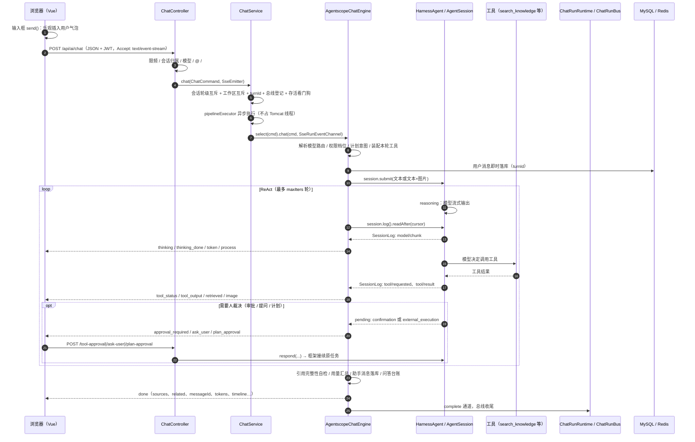

# 问渠：发送一个问题之后的完整链路

> 适用版本：当前工作区（2026-10-18，单引擎 AgentScope 框架引擎；手写 legacy 推理循环已退役）。
> 文中 `文件:行号` 以当前代码为准。带「读码现状」的段落是静态阅读结论，文末给了对应的实测方法。

## 0. 一句话版本

浏览器把问题 `POST /api/ai/chat` 进来，`ChatController` 只做**同步校验**并返回一个 `SseEmitter`；真正的整轮问答被丢进 `ChatService` 的流水线线程池，由 `AgentscopeChatEngine` 把问题 `submit` 给一条常驻的 `AgentSession`。之后是 AgentScope `HarnessAgent` 内部的 ReAct 循环：**模型流式推理 → 需要时调工具（检索/沙盒/MCP/咨询）→ 工具结果回给模型 → 再推理**，直到模型不再要工具或撞上轮数上限。问渠不拥有这个循环，只做四件事：装配模型与工具、把框架的 `SessionLog` 翻译成既有 SSE 事件、接住框架的人在回路待办、收尾时做引用校验与落库。

```
浏览器 → /api/ai/chat → ChatController → ChatService（轮次外壳）
      → AgentscopeChatEngine → AgentSession.submit → HarnessAgent(ReAct)
      → SessionLog → translate → SSE → 浏览器
      → finish：引用完整性 + 用量 + 助手消息落库 + done
```

### 0.1 参与组件

| 组件 | 在本链路中的角色 |
|---|---|
| 浏览器（Vue 3） | 乐观渲染用户气泡、维持 SSE 读流、按事件更新正文/思考/工具卡/引用/产物 |
| Spring Boot（`/ai` 上下文） | 鉴权、限流、会话、模型路由、轮次外壳、框架引擎、SSE 扇出 |
| AgentScope `HarnessAgent` / `AgentSession` | ReAct 循环、工具派发、会话状态、压缩、记忆、计划、子智能体、HITL |
| MySQL | 会话/消息/引用/工具卡/用量/问答台账/配置/智能体/知识库元数据 |
| Redis Stack | 向量索引（按知识库独立索引）；可选框架状态存储、配置广播、限频/锁 |
| Meilisearch（可选） | 关键词召回；不可用时降级 MySQL LIKE |
| 模型网关 | OpenAI 兼容供应商（DeepSeek/GLM/Qwen/Kimi/…），流式 chat completions |
| Docker 沙盒 / provisioner | `execute`、文件读写、`run_code` 的隔离执行 |
| MCP Server（可选） | 外部工具；按用户连接池接入，工具名动态进 Toolkit |
| 产物存储 / 签名 URL | `artifact` 落盘、卡片 URL、图片 HMAC 签名 |

> 部署视角（默认开发端口）：浏览器 `:5800` → Vite `/proxy` → Spring Boot `:8090/ai` → MySQL、Redis `:6379`、Meilisearch `:7700`、模型网关、沙盒 provisioner `:8002`。生产可经 nginx/平台网关，端口以实际环境为准。

## 1. 端到端时序



## 2. 阶段 A：浏览器端

| 步骤 | 位置 | 做什么 |
|---|---|---|
| A1 | `web/src/chat/useChatEngine.js:1082` `send()` | 取输入框文本、图片、附件、技能、@/# 引用；生成中的再次发送会进入「插话队列」，不发请求 |
| A2 | `useChatEngine.js:1120` 附近 | 本地 `messages.push(userMsg)` 乐观插入用户气泡，清空输入框 |
| A3 | `useChatEngine.js:1781` `streamAnswer()` | 组装本轮参数，注册所有 SSE 回调（onToken / onToolStatus / onDone / …） |
| A4 | `web/src/api.js:281` `sendQuestion()` | `fetch('/proxy/api/ai/chat')`，`Authorization: Bearer <JWT>`，请求体只带 `fileId` 不带附件内容 |
| A5 | `api.js:173` `streamChatSse()` | 读 `ReadableStream`、按行解析 `data:`、120s 空闲看门狗（页面隐藏时停表）、终态只收一次 |
| A6 | `api.js:93` `CHAT_EVENT_CB` | 事件名 → 回调名唯一映射；未识别事件打 warn 后忽略 |
| A7 | `useChatEngine.js:2177` `onDone()` | 用 `done.finalContent` 校正本地累积的正文，挂 `sources`、`related`、`messageId`、`turnId`、`tokens`、`elapsedMs` 等 |

浏览器端只做「展示 + 传输」，不做任何业务裁决。`done` 的 `messageId`/`userMessageId` 是后续「编辑重发 / 重新生成 / 分支切换」的锚点。

## 3. 阶段 B：HTTP 入口（同步段）

入口：`src/main/java/com/wenqu/ai/controller/ChatController.java:138`。

按执行顺序：

1. **鉴权拦截器**（在 Controller 之前）
   - `UserContextInterceptor`：解析 `Authorization: Bearer <JWT>` → `RequestUser`（ThreadLocal）；无令牌按 `anonymous`，不信任任何客户端自报身份。见 `config/UserContextInterceptor.java:60`。
   - `SecurityConfig`：API Key、登录门禁、RBAC 端点白名单。`POST /api/ai/chat` 在普通用户白名单内（`config/SecurityConfig.java:75` 附近）。
2. **限频**：`rateLimitService.checkRateLimit("chat", user:uid 或 ip:… )`（`ChatController.java:140`）。
3. **图片校验**：数量、`data:image/*` 形态、单张体积（`ChatController.java:145-165`）。
4. **附件校验**：请求体只带 `fileId`；按当前用户查落盘元信息，名称/MIME 以服务端为准（`ChatController.java:169-187`）。
5. **会话**：没带 `sessionId` 就新建；带了就校验归属，404 时补建（`ChatController.java:190-203`）。
6. **模型**：`modelRegistryService.assertUsable(...)` 归属校验；显式切换模型时写回会话级覆盖（`ChatController.java:205-226`）。
7. **@ 引用**：类型只允许 `kb/doc/agent`，逐个校验存在性与可见性，展示名以库为准（`ChatController.java:230`、`validateMentions`）。
8. **# 历史引用**：`messageId` 必须属于当前会话，内容由服务端查库回填（`ChatController.java:233`、`validateHistoryRefs`）。
9. **编辑重发**：`prepareEditBranch` 在同步段完成旧分支软删/快照，异常直接 4xx，不会变成流里的错误帧（`ChatController.java:238-243`）。
10. **出口**：`new SseEmitter(0L)`（`ChatController.java:249`）——刻意不设容器级超时，整轮截断交给 `TurnDeadline` 的机器耗时预算；然后 `chatService.chat(ChatCommand, emitter)`，立即返回 emitter。

同步段的原则是 **fail-loud**：所有能提前判死的（越权、模型不可用、引用不存在、附件过期）都在这里以 4xx 返回，而不是等异步线程里再发一条 `error`。

## 4. 阶段 C：轮次外壳

入口：`src/main/java/com/wenqu/ai/service/ChatService.java:443` `chat()`。

这一段回答的是「这一轮谁来做、从哪条路做」，不参与生成：

1. **会话轮级互斥**：`runtime.tryBeginTurn(sessionId)`，同一会话同时只允许一轮。并发第二问直接收到 `error` 帧（`ChatService.java:453`）。
2. **工作区互斥**：同一工作区共用一个沙盒目录，用户对话 / 定时任务 / 工作流三方互斥（`ChatService.java:465`）。
3. **轮次身份**：`turnId = UUID`，`TurnRegistry.registerHandle(sessionId, TurnHandle)`。之后消息落库、事件账本、待办、停止都挂这个 ID（`ChatService.java:472`）。
4. **断线总线**：`chatRunBus.open(...)` 把「这一轮的执行」与「这一条 SSE 连接」解耦；刷新/换设备可以接回来。收集型通道（定时任务/MCP/子代理）不登记（`ChatService.java:485`，`service/ChatRunBus.java:189`）。
5. **存活看门狗**：`new TurnDeadline(...)` + `startTurnWatchdog(...)`，按**机器耗时**判超时（人工等待不计入），默认 `chat.sseTimeoutMs=300000`（`ChatService.java:496`）。
6. **线程池**：`pipelineExecutor`（`chat.pipelineThreads` 个线程，队列 200，`AbortPolicy`）。整轮在独立线程跑，重活不占 Tomcat 请求线程（`ChatService.java:508`）。
7. **身份与配置覆盖**：从用户档案装载 `RequestUser`，装载个人设置覆盖与智能体检索参数覆盖。框架工具跑在弹性线程上，所以这些 ThreadLocal 必须在这里装、在 `finally` 清（`ChatService.java:515-528`）。
8. **分派**：
   - 智能体绑定了工作流 → `runWorkflowBoundTurn()`（工作流 `end` 节点出参当回答，不走常规生成）。
   - 否则 → `chatEngines.select(cmd).chat(cmd, dispatchChannel)`，当前恒为 `AgentscopeChatEngine`（`ChatService.java:530-539`）。
9. **收尾清理**：摘轮次把手、关总线、放开两把互斥锁、清 ThreadLocal；按标记写「用户停止」或「无人观看被中断」（`ChatService.java:541-560`）。

> `SseRunEventChannel`（`engine/SseRunEventChannel.java`）是引擎与 SSE 之间唯一的出口适配器，内部仍然走 `ChatRunRuntime.sendSseEvent`。

## 5. 阶段 D：框架引擎开轮

入口：`src/main/java/com/wenqu/ai/agentx/AgentscopeChatEngine.java:362` `chat()`。

按执行顺序：

1. **模型解析**：`modelResolver.apply(cmd)`，优先级「请求覆盖 > 会话固定 > 个人默认」；不可用时 `failLoud`，不发上游（`:365`）。
2. **路由**：`modelRegistry.chatRoute(ref)` 解析出 `baseUrl / apiKey / modelId / completionsPath`（`:377`）。
3. **权限档位**：`tools.policyFor(cmd, ...)` → `ExecutionPolicy`（auto / ask / off），影响工具挂载与审批（`:382`）。
4. **计划意图**（与后面并行）：`plan.startIntentCheck(...)` 起一个短 LLM 判定；`awaitIntent` 最多等 1.5s，超时按「不自动开计划」处理（`:386`，`agent/plan/PlanModeService.java:85,137`）。
5. **本轮引用池**：`tools.newPool(cmd, emitter)`，统一 `[1..N]` 编号空间与图片编号（`:391`，`agentx/WenquSourcePool.java`）。
6. **本轮工具落点袋**：`tools.newHooks(...)` 快照身份、配置覆盖、外溢队列、咨询台账（`:402`）。
7. **智能体绑定**：`bindingOf(cmd)` 一次解析出人设、技能白名单、实例重建键（`:406`）。
8. **打开/复用会话实例**：`sessions.open(cmd, ref, binding.key(), ctx -> buildAgent(...))`。实例按会话常驻；换模型、换绑定、`/compact` 后重建，但状态在 `stateStore`，历史不丢（`:409`，`agentx/FrameworkSessions.java:175`）。
9. **归档卡死的上一轮**：`reconcileStalledTurn(...)`。框架只把 `completed/cancelled` 当结束，上游 401 留下的 `failed` 会让这条会话以后每一轮都启动不了（`:412`）。
10. **按轮归零预算/闸门**：`stepBudget.beginTurn(...)`、`toolGate.beginTurn(...)`（`:414-425`）。
11. **记录起点**：`historyBefore = transcript.size()`、`startCursor = log().head().seq()`。两个游标都必须从「本轮开跑之前」起读，否则会把历史当增量重发（`:428-431`）。
12. **图片**：按 `visionCapableOf(ref)` 分两条路——能读图就 `processDirect`（落盘 + 保留原图直发），不能读就 `processDisplay`（只落盘回显），并在问题后追加「图片内容对你不可见，请勿猜测」的说明（`:433-464`）。
13. **用户消息即时落库**：`sessionService.appendMessage(..., turnId)`。这一轮后面即使停掉/报错，界面上也不会出现「问出去了却什么都没有」的空档（`:469`）。
14. **计划模式**：用户开了 `planMode` 或意图判定命中 → `sessions.setPlanMode(cmd, true)`；没进激活位会显式告警（`:482-495`）。
15. **装配送进模型的内容**：`userContentWithContext(...)` 依次拼：问题原文、附件正文、@ 引用清单、# 历史问答、点名技能正文；再拼图片不可见说明（`:499`，`:260`）。
16. **提交**：能读图时构造多模态 `Msg`（TextBlock + ImageBlock），否则纯文本 `session.submit(modelInput)`（`:507-509`）。
17. **占跟随位**：`sessions.claimFollower(sessionKey)`，然后 `followTurn(...)` 跟到收尾；`finally` 让位（`:512-518`）。

`buildAgent(...)`（`:2266`）是这一轮所有「框架能力」的装配点，关键项：

- `sysPrompt`：智能体人设 + 工作区约定 + 可咨询助手说明 + 计划口径 + 下一步建议提示词。
- `model`：`OpenAIChatModel`（OpenAI 兼容网关），`stream(true)`，`generateOptions` 里下发温度/思考强度，`contextWindowSize` 跟用户选择或模型登记。
- `toolkit`：本轮挂载的所有工具（见阶段 F）。
- `maxIters`：默认 12（`chat.agentscopeMaxIters`）。
- `enablePlanMode()`：框架原生 `plan_enter/write/exit`。
- `compaction(...)`、`memory(...)`、`stateStore(...)`、`workspace(...)`。
- `permissionContext(...)`：档位 → 框架权限模式 + deny 规则。
- `enablePendingToolRecovery(true)`：待办持久化、答复后接续原任务。
- `middleware(stepBudget)`、`middleware(toolGate)`：步数预算与档位闸。
- 子智能体、技能、记忆、工作区上下文：均交给框架原生中间件；`skillFilter` 决定智能体的「技能范围」。
- `abstractFilesystem(...)`、`artifactDeliveryTarget(...)`：沙盒文件系统与产物交付。

## 6. 阶段 E：框架内部 ReAct 循环

`session.submit(...)` 并不直接跑模型：它把命令写进 `SessionInbox`，`AgentSession` 的投递循环每 100ms 取一次命令，在 `boundedElastic` 上跑，并返回一个 `Task`。`followTurn` 用这个 `Task` 与 `SessionLog` 跟随。

框架内部的 `HarnessAgent` 包着 `ReActAgent`（`io.agentscope.harness.agent.HarnessAgent` / `io.agentscope.core.ReActAgent`），一轮的基本节拍是：

1. **reasoning**：把 system prompt + 历史 + 本轮输入 + 工具 schema 发给模型，流式读回 `thinking` / `text` / `tool_use` 块。每块都以 `model/chunk` 写进 `SessionLog`。
2. **post-reasoning**：运行中间件（压缩、记忆、计划、子智能体、权限等）。
3. **acting**：执行本轮待处理的工具调用。工具抛 `ToolSuspendException` 或权限判定为 `ask` 时，这一轮**挂起**，变成 `pending`，等用户裁决后由 `AgentSession.respond(...)` 接续。
4. **下一轮**：把工具结果写回上下文，回到 reasoning；直到模型不再要工具、或被 `maxIters` 截断、或被停止/挂起。

工具侧的几个关键事实：

- 问渠的工具统一产出 Spring AI `ToolCallback`，再由 `SpringAiToolAdapter` 翻译成 AgentScope 的 `ToolBase`。schema、工具名、说明都只有一份，审批与权限也挂在这个适配器上（`agentx/SpringAiToolAdapter.java`）。
- 工具执行在框架的弹性线程上，`RequestUser` 与 `configService` 的 ThreadLocal 会丢。所以 `WenquAgentxTools.newHooks` 在发起线程取快照，工具内部用 `RequestUser.restore(...)` + `putOverrides(...)` 重放。
- 工具族：`BUILTIN / KNOWLEDGE / WEBSEARCH / ARTIFACT / SKILL / TODO / SANDBOX / SUBAGENT / MCP`（`agent/tool/ToolFamily.java`）。挂不挂由 `ToolAssemblyService.mountContext(...)` 与智能体配置共同决定。
- 知识族特殊：`search_knowledge` 由 `WenquAgentxTools.KnowledgeTools` 直接挂进 Toolkit；`KnowledgeToolProvider` 的回调只收进本轮 `rawCallbacks`，供 `run_code` 脚本子调用，不再重复挂一遍（`WenquAgentxTools.java:181-200`）。
- `askUser` 用框架原生 `AskUserTool`；`writeTodo` 是问渠工具，但清单的权威存储借框架 `AgentState`（`TodoBridge`）。
- 子智能体有两套并存：框架原生 `agent_spawn/agent_send/agent_list`（派活）与问渠 `consultAgent`（咨询另一位助手，起一条完整子轮）。后者会创建一个临时会话、用 `CollectingSseEmitter` 跑完整轮，把过程事件转成 `subagent_step` 给父轮，最后把结论与引用回填父轮（`agent/subagent/SubAgentBranchRuntime.java:64`）。

## 7. 阶段 F：检索工具链路（真正发生 RAG 的地方）

当前单引擎路径下，**检索不是生成前的固定阶段，而是模型按需调用的一把工具**。模型判断「现有信息不够」时调用 `search_knowledge`：

1. `WenquAgentxTools.KnowledgeTools.searchKnowledge(query, topK)`（`agentx/WenquAgentxTools.java:547`）
   - 重放调用者身份与本轮配置覆盖；
   - 调用 `KnowledgeRetrievalTool.searchKnowledge(...)`。
2. `KnowledgeRetrievalTool.searchKnowledge`（`service/KnowledgeRetrievalTool.java:158`）
   - `topK` 上限受 `tool.knowledgeRetrieval.maxHits` 约束（1~5）；
   - `hybridRetrievalService.search(query, diag, scope.kbIds(), true)`；
   - 按 `scope.docIds` 做文档级后过滤；
   - `rerankService.rankForced(hits, query)` 强制重排（候选可能不足 6 条，不能走 `rank()` 的窗口）；
   - 分域双门：重排分走 `retrieval.minContextScore`（默认 0.6），未重排的融合分走 `retrieval.minFusionScore`（默认 0.5）；
   - 命中块注册进本轮引用池，工具文本用 `【引用N】` 标注，并附「本段相关截图：[图片N]」；
   - 未命中时把诊断原因（向量路失败/关键词路降级/库门下推失败）一并返回给模型。
3. `HybridRetrievalService.search`（`service/HybridRetrievalService.java:162`）
   - 向量路：按库分组的 RediSearch 向量索引，`retrieval.vectorTopK`（默认 15）；
   - 关键词路：Meilisearch，失败降级 MySQL LIKE，带 800ms 超时与独立线程池；
   - `loadKnowledgeBatch` 批量取知识块元数据，`loadNonRetrievableDocIds` 剔除弃用/解析中/失败文档；
   - **晚绑定可见性**：只对本轮命中的 docId 批量查一次 `ResourceVisibilityService`，不在召回前全表扫；
   - 融合：`vectorWeight × 归一化向量分 + keywordWeight × 词频分`，双命中相加；
   - GraphRAG：按库级开关做一跳图扩展（`graphRagService.expand`）。
4. `RerankService`：对候选做语义重排；不可用时回退融合分序，并在引用侧登记 `rerankUnavailable` 降级。
5. `TurnSourceRegistry`：全轮唯一的引用编号真源。工具、联网、被咨询子轮、图片都往这一套 `[1..N]` 里续编，前端引用面板与正文角标才能对上（`agent/chat/TurnSourceRegistry.java`）。

> 这条链路与 README 架构图里的「查询改写 → 混合检索 → 重排 → 上下文组装」不是同一段代码。见文末「读码现状」。

## 8. 阶段 G：事件如何回到浏览器

### 8.1 框架事件 → 问渠事件

`followTurn` 的主循环每 200ms 左右做一次：

```
drain(session, cursor, emitFrom, channel, recording)
  → 按进入时的 head 快照翻页：session.log().readAfter(cursor, 200) 一直读到游标追上快照
  → translate(event, channel, recording)
```

一次只取一页是旧的写法：`readAfter` 的第二个参数是「最多这么多条」的截断上界，不是「都给你」。
收尾那一次 `drain` 是全轮最后一次读，只走一页、之后没人再推进游标——积压超过一页时尾部整页丢掉，
丢掉的正好是最后的正文增量。这条按「拆掉隐形上限」改，不当已定案的根因（照同一族问题跑 7 轮、
每轮 1350–1776 帧没复现出来）；标签到不了用户眼前由第 9 节第 1 条那个回退兜底保证。

`translate`（`AgentscopeChatEngine.java:1888`）只翻译前端认识的事件，其余 `run/*`、`step/*`、`state/*` 刻意不发：

| 框架 `SessionLog` 事件 | 问渠 SSE | 说明 |
|---|---|---|
| `model/chunk` + `thinking` 块 | `thinking` | 思考链增量；正文开始时补 `thinking_done` |
| `model/chunk` + `text` 块 | `token` | 正文增量；同时解析 `<related>` 推荐块与 `<process>` 过程独白 |
| 同上，`<process>` 部分 | `process` | 过程独白单独走一条通道，前端灰字展示 |
| `tool/requested` | `tool_status`（status=`start`） | 先收思考段，再发工具卡；记录 `callId`/入参/开始时刻 |
| `tool/result` | `tool_status`（status=`done`/`error`） | 扣掉人在回路等待后算耗时；带结果或错误 |
| `plan/changed` | `plan` 或 `plan_delta` | 能解析成步骤数组就发整份，否则发增量文本 |
| `turn/interrupted` | `warn` | 「本轮已被中断」 |
| `tool/decision` + DENY | `warn` | 「该操作被权限档位拒绝」 |

其他事件不经过 `translate`：

- `image`：引用池注册到带图来源时，由 `TurnSourceRegistry` 直接 `sendSseEvent("image", ...)`。
- `retrieved`：`followTurn` 里发现 `sources` 数量变化就发一次，收尾再发终值（`AgentscopeChatEngine.java:2689`）。载荷 `{keywords, refs, terms}`，`terms` 优先取模型真实发出的 `search_knowledge.query`。
- `usage`：`emitLiveUsage` 按 transcript 条数变化触发；收尾发终值。
- `artifact` / `todo` / `subagent*` / `agent_consulted`：由对应工具或服务直接发。
- `approval_required` / `ask_user` / `plan_approval` / `plan_cancelled` / `plan_superseded`：`announcePending` 与计划收尾逻辑发。

### 8.2 SSE 出口

`SseRunEventChannel.emit(...)` → `ChatRunRuntime.sendSseEvent(emitter, type, content, sessionId)`（`agent/chat/ChatRunRuntime.java:371`）：

1. **结构性事件进账本**：`LEDGER_SSE_TYPES`（approval_required、ask_user、plan、plan_approval、artifact、subagent、retrieved、usage、error、warn…）写 `SessionEventService`，供刷新后回放。
2. **优先走运行总线**：`chatRunBus.publish(...)`。总线给每帧一个本轮单调 `seq`，扇出给当前所有订阅者；没人看也照发，宽限期到点才中止。
3. **没登记总线时直接写 emitter**：`SseEmitter.event().name(type).data("{\"type\":...,\"content\":...,\"sessionId\":...}")`。
4. **写失败标记断开**：`ACTIVE_SSE` 置 dead，后续等待点短路 LLM/检索开销。

前端 `streamChatSse` 解析 `data:` 行，按 `CHAT_EVENT_CB` 派发；`done`/`error` 是终止事件，不进表。

## 9. 阶段 H：收尾与落库

`finish(...)`（`AgentscopeChatEngine.java:2490`）在跟随循环退出后执行：

1. **正文取舍**：优先本轮实际流出的 `recording.answerText()`；为空且本轮没失败时，才回退到会话里最后一条助手消息（避免把上一轮的回答存进这一轮）。回退那一份出自框架 transcript、没进过流式剥离器，落库前要再过一次同一个 `RelatedStreamFilter`——否则标签原文印进回答，而芯片（下面第 4 条）也一起没了。
2. **失败判据**：`runFailure(session, current)` 读框架的 `executionError()` / 任务 `rejected`；有失败且正文为空 → `emitRunFailure`，按额度/限流/连不上/其它给可行动文案。
3. **半程轮标记**：被用户停止、等待超时、无人观看被中断，分别追加不同后缀；只有过程没有正文时也可能落库（`hasProcess`），但真空轮不落。
4. **推荐块合并**：两道护栏都在 `RelatedStreamFilter` 里——条目数超过配置的那个条数（`retrieval.relatedCount` + 2 余量）就判整块是正文、一颗芯片不出；否则只把长过 80 字的那几条并回回答，并登记降级。前者治的是「模型把整份文档塞进 `<related>`」：按 `|` 与换行拆条后每条都过得了单条长度闸，界面上会是一整屏芯片（真机 2026-10-18 21:00，71 条）。
5. **引用完整性自检**：`CitationIntegrityService.check(...)`——
   - 剔除正文里悬空的 `[N]`；
   - 「有来源却没标 `[N]`」fail-loud；
   - 可选 LLM 自检「编号对上了但语义不支撑」；
   - 自检后重新编号 sources 与 images，保证正文角标、引用面板、图片清单三方对齐。
6. **用量**：`usageOf(...)` 只累计本轮新增消息的 `ChatUsage`，输出 prompt/output/cached/分类明细/压缩轮数等；加上 `thinkingChars`、`turnElapsedMs`、`humanWaitMs`。
7. **暗截断对账**：生成 tokens 与「正文 + 思考 + 工具入参」字符数严重不符时，追加 `OUTPUT_LOST_SUFFIX` 并登记降级。
8. **终值事件**：`usage`、`retrieved`（状态行「搜索 N 个关键词，参考 M 段资料」）。
9. **助手消息落库**：`sessionService.appendMessage(sessionId, "assistant", body, images, sources, thinking, retrieved, artifacts, toolCalls, ..., tokens, timeline, process, agentId, agentName, model, related, plan, turnId)`（`:2595`）。
   - 如果这一轮只是挂着待办、暂时没人跟（`awaiting=true`），不落助手消息——等用户答完后由接续的跟随者收尾落库；否则同一问会出现两条助手消息。
   - 同时 `saveMessageWarn(...)` 把最后一条 `warn` 落库，刷新后警示条还在。
   - `qaLog.logAsync(...)` 写问答台账（看板/坏例/未命中问题）。
10. **`done` 帧**：`finalContent`、`sources`、`related`、`messageId`、`userMessageId`、`turnId`、`model`、`agentId/agentName`、`finalImages`（已签名）、`degradations`、`elapsedMs/humanWaitMs`、`tokens`、`toolCalls`、`artifacts`、`thinking`、`timeline`、`planRecord`、`engine="agentscope"`。
11. **关通道**：`channel.complete()`。不关的话前端要等 300s 看门狗才落地。

## 10. 阶段 I：人在回路、停止、续跑、插话

### 10.1 待办三形态

`announcePending`（`AgentscopeChatEngine.java:2059`）按框架 `pending` 的 `kind` 分流：

| 形态 | 判据 | SSE | 等待预算 | 用户入口 |
|---|---|---|---|---|
| 工具审批 | `kind=confirmation`，工具名不以 `plan_` 开头 | `approval_required` | `chat.approvalTimeoutMs`（默认 120s） | `POST /tool-approval/{id}` |
| 提问 | `kind=external_execution` 或未知 kind | `ask_user` | `chat.askTimeoutMs`（默认 600s） | `POST /ask-user/{id}` |
| 计划批准 | `kind=confirmation` 且工具名 `plan_*` | `plan_approval` | `chat.planTimeoutMs`（默认 600s） | `POST /plan-approval/{id}` |

裁决经 `HitlDecisionService` → `FrameworkSessions.respond(...)` → `AgentSession.respond(...)`，框架**找回原任务与原工具调用**接续执行。答复后如果原来那条跟随循环已经退出，`ensureFollowing` 会补起一个新的。

等待期间 `beginHumanWait/endHumanWait` 把这段从机器预算里扣掉——否则用户读卡三分钟，这一轮会被判超时。

### 10.2 停止

`POST /chat/stop` → `ChatRunRuntime.stopTurn(sessionId, uid)`（`ChatController.java:373`，`ChatRunRuntime.java:111`）：

- 校验「停止人 == 发起人」；
- 置 `TurnHandle.stopped`；
- 关通道；
- 引擎在循环检查点看到 `tools.stopRequested(cmd)` 就 `session.interrupt()`，收尾按「用户停止」落半程正文；
- 终止标记由 `ChatService` 的 `finally` 写，避免抢在落库之前判「没有回答」。

### 10.3 断线续跑

- 前端切会话/刷新时先 `GET /chat/run?sessionId=` 探测（`ChatController.java:401`）；
- 有在跑的轮才开 `GET /chat/resume`（`ChatController.java:415`）；
- 服务端 `ChatRunBus.attach(run, emitter)` 在锁内「取快照 + 登记订阅者」，先送 `snapshot`（已产出的正文/过程/思考/工具卡/时间线/引用/产物/计划 + 镜像事件），之后只送该快照之后 `seq` 的增量；
- 观众走光不掐轮：宽限 `chat.detachGraceMs`（默认 180s）到点才 `abortTurnWithoutViewer`，按「被中断」落半程；
- 进程重启后总线为空，`resume` 返回 `running:false`，前端按历史回显。

### 10.4 运行中插话

`POST /chat/steer` → `steerTurn`（`ChatRunRuntime.java:266`）：

- 单轮最多 3 条、单条 800 字；
- 先按普通用户消息落库（同一 `turnId`），再入队；
- 设计口径是**下一个工具步**送达（工具循环由框架持有，掐不掉正在执行的那一步）；
- 本轮结束仍未送出的，设计上随 `done.pendingSteers` 回落，前端作为同一句话续发新一轮。工作流旁路确实调了 `attachLeftoverSteers`；框架引擎的 `finish` 当前未见该调用，读码现状见第 13 节第 7 条。

## 11. 失败与超时对照表

| 场景 | 发生点 | 用户看到 |
|---|---|---|
| 未登录/令牌失效 | `UserContextInterceptor` | 401 + `登录状态已失效` |
| 非白名单端点/无权限 | `SecurityConfig` | 403 |
| 限频 | `ChatController` | 业务错误（按 `rateLimit` 配置文案） |
| 会话并发 | `ChatService.tryBeginTurn` | `error`：上一轮还在回答中 |
| 工作区并发 | `ProjectTurnMutex` | `error`：这个工作区里已有任务在跑 |
| 模型未指定/不可用 | `AgentscopeChatEngine.chat` / `failLoud` | `error` + 空 `done`，引导去选模型 |
| 上游 402/429/连不上 | `runFailure` / `emitRunFailure` | 额度不足 / 限流 / 无法连接 AI 服务 |
| 上游 401 留下 failed 轮 | `reconcileStalledTurn` 下一轮归档 | 不会永久卡死 |
| 框架未启动 | `neverLaunched` | `error`：框架引擎本轮没有开始执行 |
| 整轮机器超时 | `TurnDeadline` / `followTurn` 预算 | `warn` + 半程正文 + 中断标记 |
| 等待裁决超时 | `pendingBudgetMs` | 计划/审批：`warn` + `plan_cancelled`/收口；提问：按「未作答」继续 |
| 队列满 | `pipelineExecutor` `AbortPolicy` | `error`：系统繁忙（当前排队 N 个请求） |
| 客户端断开 | `sendSseEvent` IOException | 后台按宽限继续；宽限到点按中断落库 |
| 引用自检不通过 | `CitationIntegrityService` | 悬空角标剔除；缺标注时 `warn`；来源重编号 |

## 12. 关键代码坐标

| 关注点 | 文件 | 位置 |
|---|---|---|
| SSE 入口 | `src/main/java/com/wenqu/ai/controller/ChatController.java` | `chat()` :138 |
| 停止/插话/探测/接流 | 同上 | :373 / :386 / :401 / :415 |
| 轮次外壳 | `src/main/java/com/wenqu/ai/service/ChatService.java` | `chat()` :443 |
| 引擎分派 | `src/main/java/com/wenqu/ai/engine/ChatEngineFactory.java` | `select()` |
| 框架开轮 | `src/main/java/com/wenqu/ai/agentx/AgentscopeChatEngine.java` | `chat()` :362 |
| 跟随/等待/收口 | 同上 | `followTurn()` :526 |
| 框架事件翻译 | 同上 | `translate()` :1888 |
| 人在回路卡片 | 同上 | `announcePending()` :2059 |
| 框架装配 | 同上 | `buildAgent()` :2266 |
| 落库与 done | 同上 | `finish()` :2490 |
| 会话实例管理 | `src/main/java/com/wenqu/ai/agentx/FrameworkSessions.java` | `open()` :175 |
| 工具挂载 | `src/main/java/com/wenqu/ai/agentx/WenquAgentxTools.java` | `frameworkTools()` :181 |
| 知识工具 | 同上 | `KnowledgeTools` :539 |
| Spring AI→AgentScope 适配 | `src/main/java/com/wenqu/ai/agentx/SpringAiToolAdapter.java` | `callAsync()` :115 |
| 检索实现 | `src/main/java/com/wenqu/ai/service/KnowledgeRetrievalTool.java` | `searchKnowledge()` :158 |
| 混合召回 | `src/main/java/com/wenqu/ai/service/HybridRetrievalService.java` | `search()` :162 |
| 引用编号 | `src/main/java/com/wenqu/ai/agent/chat/TurnSourceRegistry.java` | — |
| SSE 发送/去重/账本 | `src/main/java/com/wenqu/ai/agent/chat/ChatRunRuntime.java` | `sendSseEvent()` :371 |
| 运行总线 | `src/main/java/com/wenqu/ai/service/ChatRunBus.java` | `open()` :189 / `publish()` :235 / `attach()` :312 |
| 前端发送 | `web/src/chat/useChatEngine.js` | `send()` :1082 / `streamAnswer()` :1781 / `onDone()` :2177 |
| 前端 SSE 内核 | `web/src/api.js` | `streamChatSse()` :173 / `sendQuestion()` :281 / `resumeChat()` :326 |

### 12.1 日志锚点（排障时先 grep 这几条）

| 日志前缀 | 出现位置 | 说明 |
|---|---|---|
| `[TURN] 本轮收口` | `AgentscopeChatEngine.followTurn` | 机器耗时 / 墙钟 / 人工等待三个数，判断超时与成本先看它 |
| `[TOOL-DIAG] searchKnowledge` | `KnowledgeRetrievalTool` | 融合召回条数、耗时、uid/线程、向量/关键词路是否失败、库门下推是否失败 |
| `[TOOL-DIAG] 重排/融合分门` | 同上 | 重排是否生效、两个门各留下多少条 |
| `[FAIL-LOUD]` | 全链路 | 明确降级/拒绝/失败，按文案定位 |
| `[RUN] 观众接流` | `ChatRunBus.attach` | 断线重连是否接上、当前观众数 |
| `[STEER]` | `ChatRunRuntime.steerTurn` | 插话是否入队、是否因超限/非本人被拒 |
| `[PLAN]` | `PlanModeService` / 引擎 | 计划意图判定、是否进入计划位 |
| `[SUBAGENT]` | `SubAgentBranchRuntime` | 子轮实时过程是否接通父轮 |
| `[agentx]` | `AgentscopeChatEngine` | 实例重建、模型切换、Redis 状态存储回退等 |

## 13. 读码现状（与 README 架构图的差异，建议实测确认）

这一节是静态阅读当前工作区代码得到的结论，不是产品承诺。前三条如果与预期不符，优先怀疑「迁移收尾没接线」，而不是检索/模型本身。

1. **固定的「查询改写 → 混合检索 → 重排 → 上下文组装」主链路当前没有调用点。**
   `RetrievalPipeline`（`agent/context/RetrievalPipeline.java`）里的 `assemble()`、`loadMentionChunks()`、`MentionScope` 在本仓库内找不到调用方；`ChatService` 的 `rewriteExecutor` 也没有使用者（只剩创建/调容/关闭）；`HybridRetrievalService.searchMulti` 只被 `RetrievalEvaluationService` 使用。
   实际发生的是：模型按需调用 `search_knowledge`，由 `KnowledgeRetrievalTool` 直接走 `HybridRetrievalService.search`（单 query、无改写、无多路、无上下文装配）。
   验证：问一个必须查库的问题，在日志里找 `[TOOL-DIAG] searchKnowledge`；如果模型没调工具，就不会有任何检索。

2. **`@` 引用的「范围收窄 / 文档前置」在当前单引擎路径没有真正接线。**
   `ChatController.validateMentions` 会校验并把 `mentions` 传进 `ChatCommand`；`AgentscopeChatEngine.userContentWithContext` 只把 `type/name` 列成一段文字，并写了一句「doc 类型的内容已由系统直接前置到本轮上下文」；但当前代码里没有任何地方按 `mentions` 去加载文档块或收窄 `KnowledgeTools.scope`（`RetrievalScopeService.resolve` 只看智能体配置，不看 `mentions`）。
   后果：`@doc` 很可能只让模型看到文件名；`@kb` 很可能没有改变检索范围；`@agent` 也没有强制咨询（见下一条）。
   验证：`@` 一篇只在该文档里出现的术语，问一个必须靠它才能答的问题；看工具调用参数与命中来源。

3. **`@agent` 的强制咨询只在工作流旁路里实现，框架引擎路径没有。**
   `ChatService.runWorkflowBoundTurn` 里有 `resolveDelegatedAgent(mentions, ...)`；框架路径的 `WenquAgentxTools.consultContext` 明确把 `forcedConsultId` 传成 `""`，注释也写了「框架引擎这一侧没有 mentions 那一段编排，如实留空」。
   后果：`@` 一位助手，模型可能不咨询它，直接自己答。
   验证：`@` 一个资料域明显不同的助手，问只有它能答的问题；看是否出现 `agent_consulted` 事件与 `consultAgent` 工具卡。

4. **框架路径的文本增量 `pos` 恒为 `null`。**
   `ChatRunRuntime.textDeltaPos` 对框架引擎恒返回 `null`；前端对 `null pos` 的帧按「无下标」处理，仍可追加，只是少了一层文本去重。接流去重主要靠 `snapshot.seq` + 每帧 `seq`。

5. **`stage` 事件已退役；`plan` 事件不再在轮次开始时固定下发。**
   进行中提示只剩「整轮用时」；右侧步骤清单来自框架 `plan/changed`（有才发）。如果某个模型/轮次没有计划变更，前端 `msg.plan` 可能为空。

6. **`retrieved` 的 `keywords` 是「模型真实发出的检索词」而不是「改写后的查询」。**
   `retrievedJson` 优先取 `recording.searchQueries`（`search_knowledge.query` 入参）；只有模型没调检索工具时才回退到 `keywordExtractor.extractMain(question)`。

7. **框架引擎路径的「运行中插话」很可能只落库、不送达模型。**
   `POST /chat/steer` 会把插话写进 `TurnHandle.steers` 队列并落一条用户消息（`ChatRunRuntime.java:266`）；旧链路在工具结果回程时由 `ToolPipelineFactory.wrap(...)` → `ToolTurnContext.appendSteers(...)` 把它拼进工具结果（`agent/tool/ToolPipelineFactory.java:148`）。但框架引擎的工具不走这条管线：`WenquAgentxTools` 里的 `appendSteers` 对脚本子调用直接原样返回；`AgentscopeChatEngine.finish` 也没有调用 `ChatRunRuntime.attachLeftoverSteers`（该方法目前只有 `ChatflowBridge` 调用）。
   后果：插话会出现在历史里，但当前这一轮模型看不到它；收尾也不会通过 `done.pendingSteers` 回落。
   验证：跑一个会调工具的长回答，中途插话，看工具结果里有没有这句话、`done` 里有没有 `pendingSteers`。

8. **README 的架构图仍按旧主链路描述。**
   `README.md` 的「问答管线：查询改写 → 混合检索 → 重排 → 上下文组装 → 流式生成」描述的是 legacy 手写运行时的形态；当前单引擎路径应以本文为准。建议在 README 架构图旁加一句指向本文，避免后来者按图找代码。

## 14. 一页速查

```
发送
  POST /api/ai/chat
  → 拦截器（JWT/RBAC）→ 限频 → 会话/模型/@/#/附件/编辑校验
  → ChatService.chat：互斥 + turnId + 总线 + 看门狗 + 线程池
  → 工作流绑定？ChatflowBridge : AgentscopeChatEngine

开轮
  → 模型路由 → 权限档位 → 计划意图（并行，最多等 1.5s）
  → 引用池 + 工具落点 + 智能体绑定
  → sessions.open（复用/重建 AgentSession）
  → 用户消息落库（turnId）
  → 组装 modelInput（附件/@/#/技能/图片说明）
  → session.submit

循环
  reasoning（模型流式）→ tool_use → acting（工具执行/挂起）
  → SessionLog → translate → SSE（thinking/token/process/tool_status/...）
  → 有待办：announcePending → 卡片 → 用户裁决 → respond → 接续
  → 直到无工具/上限/停止/超时

收尾
  → 引用完整性 → 用量 → 助手消息落库 → 问答台账
  → done（sources/related/messageId/tokens/timeline/...）→ complete
```

---

维护提示：本文按「阶段」组织，新增能力时优先改对应阶段的小节与第 12 节坐标表；如果新增/改名了 SSE 事件，还要同步 `engine/RunEventType.java`、`web/src/api.js` 的 `CHAT_EVENT_CB` 与 `web/scripts/check-sse-contract.mjs`。
